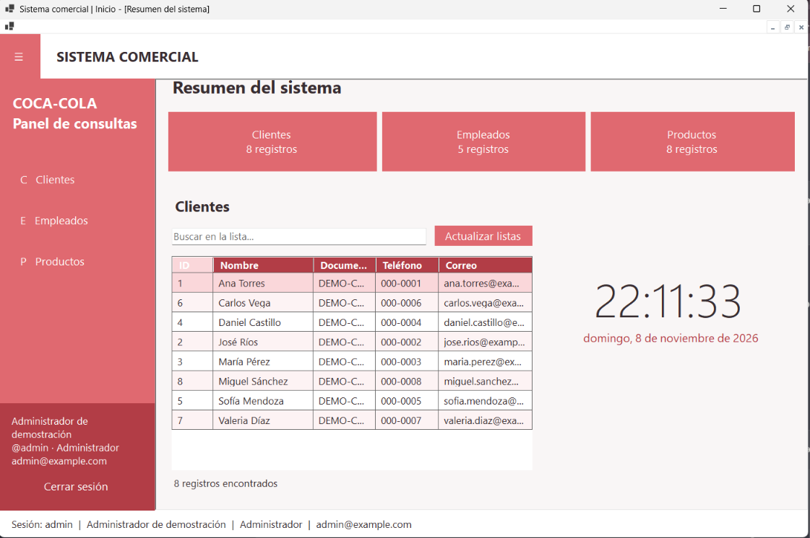
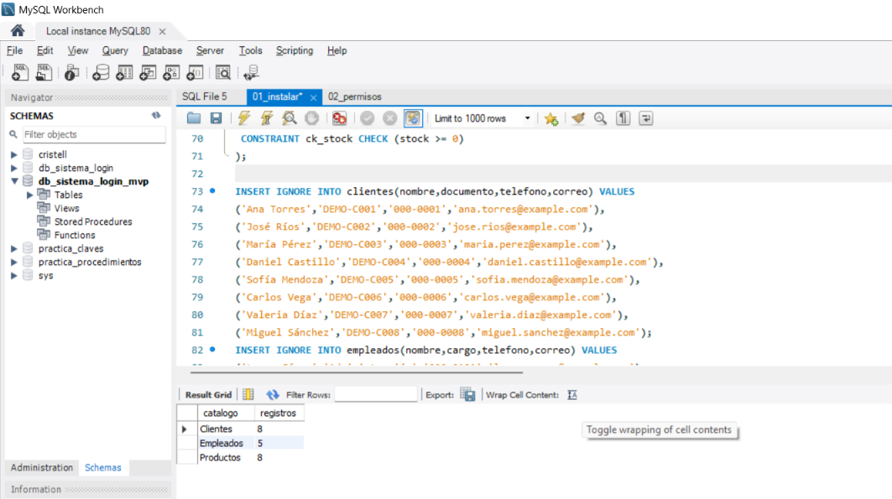
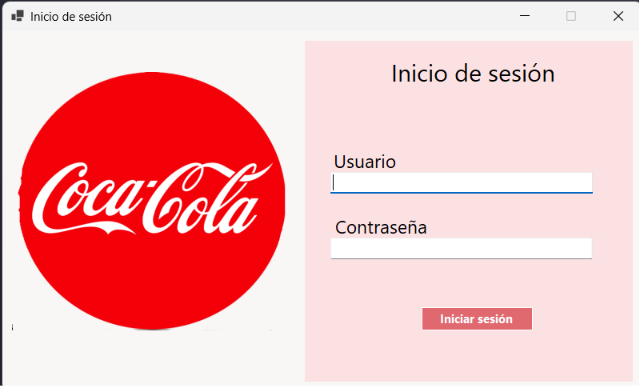
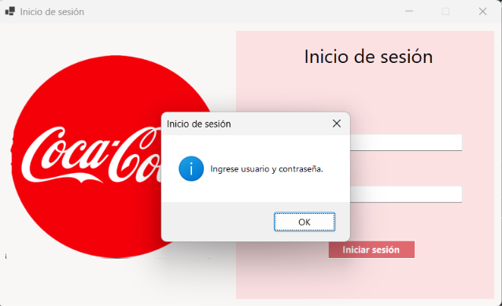
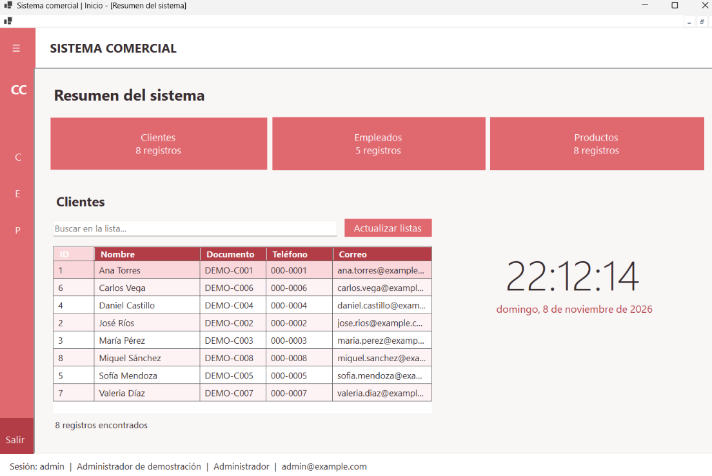
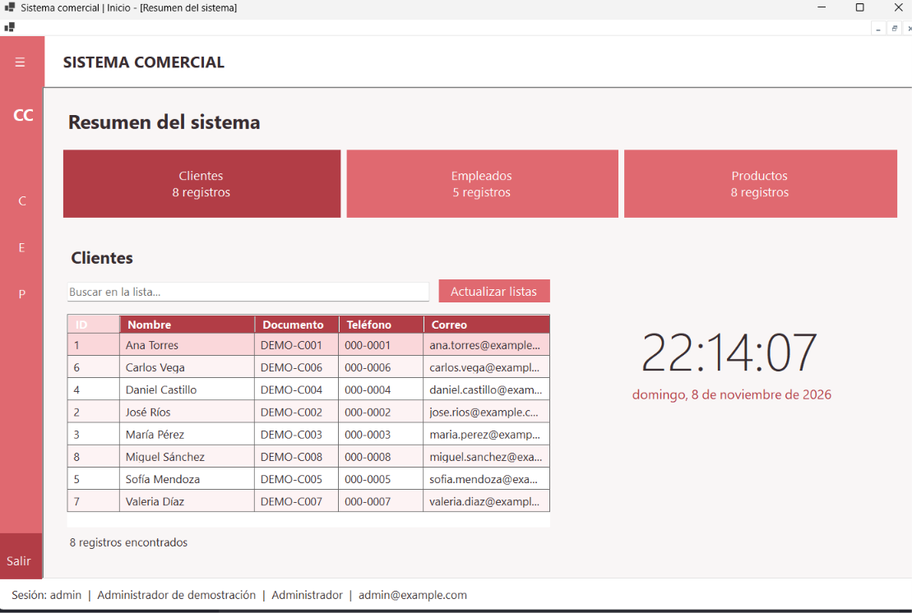
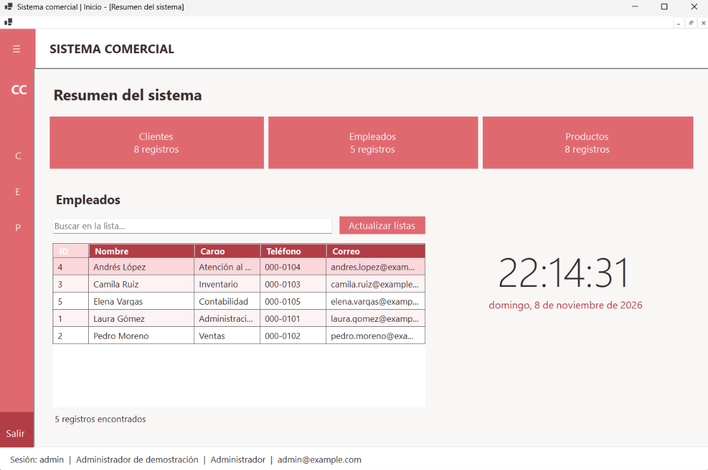
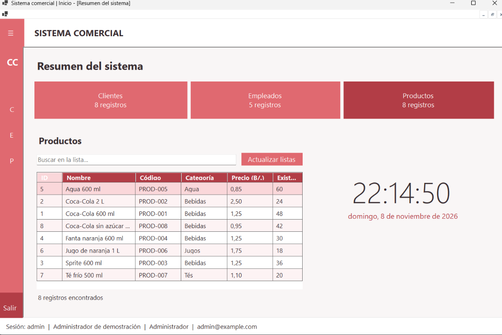

# Parcial #2 Práctico - Capas y patrón MVP

## Información del parcial

| Dato | Información |
|---|---|
| Universidad | Universidad Tecnológica de Panamá |
| Facultad | Facultad de Ingeniería de Sistemas Computacionales |
| Curso | Herramientas de la Programación Aplicada III (.NET) |
| Evaluación | Parcial #2 Práctico - Capas |
| Estudiante | Cristell Peters |
| Grupo | 1IL133 |
| Carrera | Ingeniería en Sistemas y Computación |
| Docente | Ing. Irina Fong |
| Año | 2026 |
| Fecha de actualización | 08/11/2026 |

## Objetivos

🩷 Organizar una aplicación de escritorio en capas para separar los datos, las reglas de negocio y la interfaz gráfica.

🩷 Implementar el patrón **Modelo-Vista-Presentador (MVP)** para que los formularios deleguen el procesamiento de las acciones en un presentador.

🩷 Crear dos contratos independientes en la capa de Negocio: uno para generar hashes y otro para verificar contraseñas.

🩷 Conectar la aplicación con MySQL mediante un usuario con permisos limitados.

🩷 Diseñar una pantalla principal con menú lateral plegable, hora actual e información del usuario que inició sesión.

## Contenido del parcial

En este parcial se desarrolló una aplicación en **C# Windows Forms** conectada a una base de datos **MySQL**. El programa permite iniciar sesión y consultar información de clientes, empleados y productos desde una pantalla principal con navegación lateral.

Se partió de un proyecto organizado en capas y se incorporó el patrón **MVP**. También se trabajó con la protección de contraseñas mediante hashes, la validación del acceso, la lectura de registros desde MySQL y la presentación de los datos en un `DataGridView`.

La pantalla principal incluye un botón de tres líneas para abrir y cerrar el menú, tarjetas con la cantidad de registros de cada módulo, un reloj con la fecha actual y la información de la sesión en la parte inferior. Los registros incluidos en la instalación son datos ficticios para demostrar el funcionamiento.

## Diseño de la aplicación

La interfaz se organizó en tres formularios. El primero corresponde al inicio de sesión; el segundo contiene el menú y la información del usuario; y el tercero presenta las listas, las tarjetas de resumen y el reloj.

Se utilizaron tonos de rojo claro y paneles para distribuir los controles. La ventana principal funciona como **contenedor MDI**, mientras que el tablero se abre dentro de ella como formulario hijo.

| Formulario | Función |
|---|---|
| `Form1` | Recibe el usuario y la contraseña para iniciar sesión. |
| `MainForm` | Contiene el menú lateral, la navegación y la información de la sesión. |
| `DashboardForm` | Presenta los registros, las búsquedas, las cantidades y el reloj. |

Cada formulario cuenta con su archivo **`.Designer.cs`** y sus recursos **`.resx`**, lo que permite abrirlo en el diseñador de Visual Studio y editar sus controles visualmente.



## Organización del proyecto en capas

Se separó el proyecto en cuatro capas para que cada una tenga una responsabilidad definida. Esto permite ubicar con mayor facilidad dónde se representan los datos, dónde se consulta la base y dónde se procesa la información.

| Capa | Trabajo realizado |
|---|---|
| **Entidades** | Se definieron los datos del usuario y los registros de clientes, empleados y productos. |
| **Datos** | Se implementó la conexión con MySQL y las consultas necesarias para recuperar los registros. |
| **Negocio** | Se colocaron la autenticación, los contratos de hash y el servicio de consulta de catálogos. |
| **Presentación** | Se crearon los formularios, los contratos de las vistas y los presentadores. |

Por ejemplo, el formulario de acceso no realiza una consulta SQL para comprobar la contraseña. Esa acción pasa por el presentador y la capa de Negocio, que utiliza la capa de Datos para recuperar la información necesaria.

## Implementación del patrón MVP

El patrón MVP se utilizó para separar lo que muestra el formulario de lo que se procesa cuando el usuario realiza una acción.

### 🩷 Modelo

El modelo está representado por las entidades y los servicios que trabajan con la información. Aquí participan clases como `E_Usuario`, los registros `Cliente`, `Empleado` y `Producto`, y los servicios de Negocio que utilizan la capa de Datos.

### 🩷 Vista

La vista corresponde a los formularios que muestran los controles y reciben las acciones del usuario. Se crearon los contratos `ILoginView` e `ICatalogoView` para definir qué información necesita cada presentador y cómo puede comunicar los resultados a la pantalla.

`Form1` implementa `ILoginView`, mientras que `DashboardForm` implementa `ICatalogoView`.

### 🩷 Presentador

Se implementaron `LoginPresenter` y `CatalogoPresenter` como intermediarios entre las vistas y los servicios de Negocio.

`LoginPresenter` recibe el intento de inicio de sesión, valida los campos y solicita la autenticación. `CatalogoPresenter` carga los catálogos y filtra los registros según el módulo y el texto de búsqueda.

De esta manera, las consultas SQL y los algoritmos de hash no se escriben dentro de los eventos de los botones de los formularios.

## Contratos para el manejo de contraseñas

En la capa de **Negocio** se crearon dos interfaces independientes, según lo solicitado para el parcial.

### 🩷 Contrato para generar el hash

La interfaz `IHashService` define únicamente la operación encargada de generar un hash a partir de una contraseña.

```csharp
public interface IHashService
{
    string GenerarHash(string password);
}
```

Esta operación está disponible para preparar una contraseña antes de almacenarla. La versión del sistema desarrollada para este parcial utiliza usuarios de demostración incluidos en el script de instalación.

### 🩷 Contrato para verificar el hash

La interfaz `IVerificarHashService` define únicamente la operación que comprueba si una contraseña coincide con el hash almacenado.

```csharp
public interface IVerificarHashService
{
    bool Verificar(string password, string hash);
}
```

Esta verificación se utiliza durante el inicio de sesión. El resultado permite determinar si las credenciales corresponden al usuario consultado.

### 🩷 Implementación de los contratos

La clase `PasswordService` implementa las dos interfaces, conservando cada contrato por separado.

```csharp
public sealed class PasswordService : IHashService, IVerificarHashService
```

Para generar el hash se utiliza **PBKDF2 con SHA-256**, 600,000 iteraciones y una sal aleatoria de 16 bytes. La sal hace que dos contraseñas iguales puedan producir hashes distintos. El resultado conserva los parámetros necesarios para verificar posteriormente la contraseña.

Al verificar, se obtiene nuevamente el valor derivado y se compara con el almacenado mediante `CryptographicOperations.FixedTimeEquals`. No se recupera la contraseña original desde el hash.

## Base de datos MySQL

La aplicación utiliza la base de datos `db_sistema_login_mvp`. Se prepararon cuatro tablas para almacenar las cuentas de acceso y los datos que se presentan en los módulos.

| Tabla | Información almacenada |
|---|---|
| `usuarios` | Identificador, usuario, hash de contraseña, estado, nombre completo, correo y rol. |
| `clientes` | Nombre, documento, teléfono y correo. |
| `empleados` | Nombre, cargo, teléfono y correo. |
| `productos` | Código, nombre, categoría, precio y existencias. |

El script `01_instalar.sql` crea la estructura e incorpora **8 clientes, 5 empleados y 8 productos** de ejemplo. También incluye cuentas activas y una cuenta inactiva para comprobar las validaciones de acceso.

Los registros de ejemplo utilizan identificadores únicos para evitar duplicarlos al repetir la instalación. El script también permite agregar los campos del perfil a la versión anterior de la tabla de usuarios sin reemplazar sus contraseñas.



## Conexión entre C# y MySQL

Se utilizó el paquete `MySql.Data` para comunicar la aplicación con MySQL. La clase `D_Conexion` obtiene la cadena de conexión desde la variable de entorno `LAB_CAPAS_CONNECTION`.

La clase `D_Usuario` busca la cuenta mediante una consulta parametrizada. Después, la capa de Negocio comprueba que esté activa y verifica la contraseña. Por su parte, `D_Catalogos` recupera los clientes, empleados y productos utilizando `MySqlCommand` y `MySqlDataReader`.

También se creó el usuario de base de datos **`lab_capas_app`**. Esta cuenta tiene permisos de lectura sobre los datos necesarios para la aplicación, por lo que no se utiliza `root` para iniciar el sistema ni consultar las listas.

## Funcionalidades principales

### 🩷 Inicio de sesión

Al presionar **Iniciar sesión**, el formulario notifica al presentador. Primero se comprueba que el usuario y la contraseña no estén vacíos y que no superen los límites establecidos.

Después se recupera la cuenta desde MySQL, se revisa su estado y se verifica el hash. Si las credenciales son correctas y la cuenta está activa, se abre la ventana principal con la información del usuario autenticado.



### 🩷 Validaciones del acceso

Se agregaron mensajes para indicar cuándo faltan datos, las credenciales son incorrectas, la cuenta está inactiva o existe un problema con la conexión.

| Situación | Respuesta del sistema |
|---|---|
| Usuario o contraseña vacíos | Solicita ingresar ambos datos. |
| Usuario con más de 50 caracteres o contraseña con más de 128 | Informa los límites permitidos. |
| Credenciales incorrectas o cuenta inactiva | Rechaza el inicio de sesión. |
| Error al conectar o consultar MySQL | Muestra un mensaje para revisar la configuración y la conexión. |

La contraseña se muestra oculta en el campo de texto. Además, el botón de acceso se deshabilita mientras se procesa la solicitud para evitar intentos repetidos al mismo tiempo.



### 🩷 Menú lateral plegable

Se agregó un menú en la parte izquierda con los botones **Clientes**, **Empleados** y **Productos**. El botón **☰** permite plegar y desplegar el menú.

Cuando se pliega, se reduce su ancho y los botones muestran una inicial. Al desplegarlo, se recuperan los textos y tamaños originales. Esto permite aprovechar el espacio de la pantalla sin perder los accesos a los módulos.




### 🩷 Consulta de clientes, empleados y productos

Cada opción del menú cambia la información presentada en el `DataGridView`. En Clientes se muestran los datos de contacto y el documento; en Empleados, el cargo y los datos de contacto; y en Productos, el código, la categoría, el precio y las existencias.

Las listas se cargan desde MySQL y se muestran en modo de solo lectura. Las tarjetas de la parte superior presentan la cantidad de registros obtenidos en cada módulo.







### 🩷 Búsqueda y actualización de las listas

El campo de búsqueda permite filtrar los datos del módulo seleccionado. Por ejemplo, se puede buscar un cliente por nombre o documento, un empleado por cargo y un producto por código o categoría.

El filtro no distingue entre mayúsculas y minúsculas. Si no existen coincidencias, la tabla queda sin filas y se muestra la cantidad de resultados encontrados.

El botón **Actualizar listas** vuelve a consultar MySQL. Esto permite visualizar cambios realizados desde Workbench sin cerrar la aplicación. La lectura se realiza fuera del hilo de la interfaz para mantener la pantalla disponible mientras se obtienen los datos.

### 🩷 Reloj y fecha actual

Se colocó un reloj grande en la parte derecha del tablero y la fecha debajo. Para actualizarlo se utiliza un `Timer` con un intervalo de un segundo.

La hora se presenta en formato `HH:mm:ss` y la fecha se muestra en español. El reloj se inicia durante la ejecución del formulario.

### 🩷 Información del usuario y cierre de sesión

En la parte inferior del menú se muestra el **nombre completo, usuario, rol y correo** de la cuenta autenticada. Esta información también aparece en la barra inferior, por lo que continúa visible cuando el menú está plegado.

El botón **Cerrar sesión** cierra la ventana principal y regresa al formulario de acceso. El campo de contraseña se limpia para permitir un nuevo inicio de sesión.

El rol se muestra como parte de la información del usuario; los usuarios activos tienen acceso a los mismos módulos de consulta.

## Instalación y ejecución

1. Tener instalado **MySQL**, el **SDK de .NET 10** y Visual Studio con las herramientas de desarrollo de escritorio .NET.
2. Abrir `sql/01_instalar.sql` en MySQL Workbench y ejecutarlo con una cuenta administradora.
3. Ejecutar `sql/02_permisos.sql` para crear la cuenta de conexión y asignar sus permisos. Revisar la contraseña definida en ese archivo; si la cuenta ya existe, conserva su contraseña anterior.
4. Guardar la conexión desde PowerShell, reemplazando `TU_CONTRASENA` por la contraseña de `lab_capas_app`:

```powershell
[Environment]::SetEnvironmentVariable('LAB_CAPAS_CONNECTION', 'Server=localhost;Database=db_sistema_login_mvp;Uid=lab_capas_app;Pwd=TU_CONTRASENA;', 'User')
```

5. Abrir nuevamente Visual Studio para que reconozca la variable y cargar `LaboratorioCapas.slnx`.
6. Establecer **Presentacion** como proyecto de inicio, restaurar los paquetes y ejecutar con **F5**.

Para comprobar el acceso se incluye la siguiente cuenta de demostración:

| Usuario | Contraseña |
|---|---|
| `admin` | `Admin123!` |

La contraseña del formulario de acceso es independiente de la contraseña utilizada para conectar con MySQL.

## Controles utilizados

| Control | Uso dentro del parcial |
|---|---|
| `Form` y contenedor MDI | Ventana de acceso, pantalla principal y tablero hijo. |
| `Panel` | Distribución del menú y la información de sesión. |
| `FlowLayoutPanel` | Organización de los botones laterales. |
| `TableLayoutPanel` | Distribución de tarjetas, listas y reloj. |
| `TextBox` | Usuario, contraseña y búsqueda. |
| `Button` | Acceso, navegación, actualización y cierre de sesión. |
| `Label` | Títulos, cantidades, hora, fecha y datos del usuario. |
| `DataGridView` | Presentación de clientes, empleados y productos. |
| `PictureBox` | Imagen del formulario de acceso. |
| `Timer` | Actualización del reloj cada segundo. |
| `ToolTip` | Ayuda sobre los botones del menú plegado y la información del usuario. |
| `MessageBox` | Mensajes de validación y errores. |

## Herramientas utilizadas

| Herramienta | Versión o configuración |
|---|---|
| C# | Versión predeterminada del SDK .NET 10. |
| .NET | `net10.0` y `net10.0-windows`. |
| SDK usado para comprobar la compilación | .NET 10.0.403. |
| Windows Forms | Interfaz de escritorio de .NET. |
| MySQL | Estructura preparada para MySQL 8; completar la versión exacta instalada. |
| MySQL Workbench | Administración y ejecución de los scripts SQL; completar la versión instalada. |
| Visual Studio | Desarrollo y edición de los formularios; completar la versión instalada. |
| NuGet / `MySql.Data` | Paquete `MySql.Data` 26.7.0. |
| GitHub | Repositorio del código fuente y documentación del proyecto. |

## Resultado del trabajo

Con este parcial se integraron la organización por capas, el patrón MVP y el acceso a una base de datos en una misma aplicación. Se separaron las responsabilidades de los formularios, se implementaron los dos contratos para el manejo de contraseñas y se agregó una cuenta de conexión con permisos limitados.

También se construyó una interfaz con navegación lateral, consultas de datos, reloj e identificación de la sesión. El desarrollo permitió relacionar la estructura del código con el funcionamiento de una aplicación de escritorio conectada a MySQL.

# Última modificación del proyecto - 08/11/2026

Se incorporaron el menú plegable, los módulos de consulta, la información del usuario y el reloj. Además, los formularios principales se organizaron con sus archivos `.Designer.cs` y `.resx` para permitir la edición visual desde Visual Studio.
